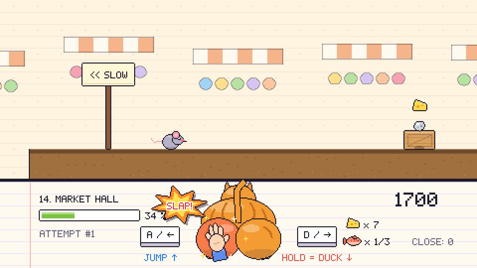

# Slappy Cat 🐱👋🐭

**▶ Play it here: https://jmoravec01.github.io/slappy-cat/** (free, in the browser, desktop and phone; leaderboards,
accounts and the market need no install)

[](https://jmoravec01.github.io/slappy-cat/)

A one-button side-scrolling runner for the browser: you slap a cat's butt,
the cat meows, and a scared mouse jumps or ducks its way through the level, straight
into a mousetrap. Then the cat you have been slapping leaps out of the panel and eats it.

Single player: everyone plays on their own, but everyone sees the same leaderboards.

- **Left cheek** (`A` / `←` / tap the left half): a hand flies onto the cheek ("SLAP!"), the cat goes "MŇAU!" and the mouse **jumps / flaps**
- **Right cheek** (`D` / `→` / finger on the right half), **held**: the hand stays on the cheek, the cat growls "MRRRR…" and the mouse **ducks until you let go**. In the air it dives.
- **Crates** can be landed on from above and walked on; hitting one from the side (or below) ends the run.
- Touching anything else (beam, pipe, spikes, a hole) ends the run too.
- `Esc` / `P` pauses, `R` restarts; gamepad LB / RB

20 maps in pixel art, as rooms of five houses: a country cottage, a city tower block, a poor
quarter, the city centre and a luxury villa (ending on the cat throne). From the living room on, foil balls roll at
the mouse, pop out of crates or drop from above. Each map unlocks the next one, has its own
leaderboard, and the overall leaderboard sums every player's best score on every map.

Works in Chromium, Firefox and Safari (desktop and mobile), with no build step and no npm dependencies.

## Run

```bash
docker compose up -d --build          # http://localhost:8077
# or without Docker (Node >= 22.13):
npm start                             # PORT=8080 DATA_DIR=./data
```

| env | default | meaning |
| --- | --- | --- |
| `PORT` | 8080 | HTTP port inside the container |
| `DATA_DIR` | `/data` (Docker) | SQLite database location (a volume) |
| `TRUST_PROXY` | 0 | set to `1` behind a reverse proxy so rate limits use `X-Forwarded-For`. Only safe when the proxy is the ONLY way in: then bind the port to loopback (`"127.0.0.1:8077:8080"`), otherwise anyone can fake the header and skip the rate limits |
| `TICKET_SECRET` | random, kept in the DB | HMAC key for run tickets and registration challenges |
| `POW_BITS` | 17 | registration proof-of-work difficulty |
| `SLAPPY_PORT` | 8077 | host port in `docker-compose.yml` |
| `CORS_ORIGINS` | empty | comma-separated sites allowed to call the API from another origin, e.g. `https://you.github.io` |

The image is about 108 MB (Alpine + Node) and uses about 20 MB of RAM. Backup = copy the `slappy-data` volume (`slappy.db`).
For HTTPS, put it behind Caddy, Traefik or nginx and set `TRUST_PROXY=1`.

## Market

Logged-in players spend salmon on looks for the cat and the mouse (`shared/skins.js`): 60 plain colours (2–12 salmon)
and 200 two-colour mixes each (stripes, points, two-tone, patches; 6–15 salmon, black/white and white/black included;
the ginger cat and the grey mouse are free). Each of a map's 3 salmon pays into the wallet once, the first time a
finished run collects it. Repeat runs of a finished map hide one bonus salmon in place of a plain cheese, picked from
the run ticket so it moves every run and the server can recompute it; it scores like the cheese it replaces, so
leaderboards stay fair, and pays one salmon. The wallet lives on the server: the API checks the balance and debits it
in one statement.

About one run in 20 (`GOLDFISH_ODDS`) of a logged-in player hides a goldfish: +10 salmon and a count on the overall
board. The roll is made with crypto randomness when the server issues the run ticket and stays on the server; the
browser learns it mid-run (`GET /api/goldfish`), and not before an honest run could be 20 % in. A player gets a new
ticket (a new roll) only after using the last one or after the time a whole run takes, so asking again and again is
no faster than playing.

## Play from GitHub Pages

The game itself is static files, so GitHub Pages can host it; the leaderboards still need this server running
somewhere reachable over HTTPS.

1. Run the server (Docker above) behind HTTPS, with `CORS_ORIGINS=https://<user>.github.io`.
2. In the GitHub repo: *Settings → Pages → Source: GitHub Actions*, and *Settings → Variables → Actions*:
   `SLAPPY_API=https://your-server.example/` (with the trailing slash).
3. Push to `main`; `.github/workflows/pages.yml` builds the site with `tools/build-pages.sh` and publishes it.

A free way to give a home server HTTPS is Tailscale Funnel (`tailscale funnel --bg 8077`); behind it set
`TRUST_PROXY=1` so rate limits see the players' addresses.

Without `SLAPPY_API` the Pages copy plays offline: everything works, progress stays in the browser, no leaderboards.

## Accounts

There's no e-mail, just a **nickname + password** (scrypt-hashed, at least 8 characters, bearer session token stored
in `localStorage`). Nicknames use Latin letters (accents allowed), digits and `_ . -`; names that only differ by case,
accents or `0/O`, `1/l/I` count as the same name, so nobody can pose as another player. Ten wrong passwords lock an
account's logins for 15 minutes, whichever IPs they come from. Guests can play right away. Their best runs are kept in the browser and uploaded
automatically the moment they register or log in.

IP-based identity was rejected on purpose: many players share one IP (home Wi-Fi, mobile carrier NAT,
school or office), and one player changes IPs all the time (phone vs. PC, dynamic IPs). The leaderboard would mix up
people and lose their scores.

## Anti-cheat

Layers, from strongest:

1. **No scores from the client.** The client uploads the run's **input log** (`[[tick, 1 flap | 2 press | 3 release], ...]`);
   the server re-plays it with the very same deterministic engine (`shared/sim.js`, fixed 60 Hz, plain arithmetic, identical
   in V8 / SpiderMonkey / JavaScriptCore) and computes the score itself. Editing memory, the score variable or the request
   body gets you nothing.
2. **Run tickets.** Opening a map fetches an HMAC-signed ticket (`GET /api/ticket`). A finished run is only accepted with a
   valid, unused ticket for that map, and **not sooner than the run takes to play** (≥ 90 % of its duration since the ticket
   was issued). Precomputed or bot-generated logs therefore can't be fired off in bulk; each one costs real time.
   Tickets are single-use (stored nonces).
3. **Human input limits.** Logs with more than 16 events per second, flaps closer than 50 ms, or impossible press/release
   sequences are rejected.
4. **Proof of work on registration.** The browser must find a SHA-256 partial collision (≈ 1–2 s on a phone) before an
   account is created; plus per-IP rate limits on register / login / tickets / runs. Cheap for a person, expensive for a
   script creating thousands of accounts.
5. **Server-side progression.** A map only accepts runs once the previous one is completed. Only the consumed part of a
   log is stored.
6. **Moderation.** Every leaderboard run is watchable (▶ replay), so suspicious runs are easy to spot, and
   `server/admin.js` can ban players (hidden from boards, sessions revoked, login blocked).
7. Changing a map automatically drops the stored runs of that map (layout hash in the DB).

Not possible to stop in any browser game: a bot that plays the game in real time. The layers above make that slow
and visible, not impossible. The real-time check only stops instant uploads: a cheater with a solver who waits out
the run length gets through, so watch suspicious replays and use the ban command.

## Backup

Everything lives in one SQLite file (`/data/slappy.db`). A consistent copy while the game runs:

```bash
docker exec slappy-cat node -e "new (require('node:sqlite').DatabaseSync)('/data/slappy.db').exec(\"VACUUM INTO '/data/backup.db'\")"
```

then copy `backup.db` off the machine (a nightly cron job is enough).

## Moderation

```bash
docker exec slappy-cat node server/admin.js top          # overall board
docker exec slappy-cat node server/admin.js top 3        # map 3
docker exec slappy-cat node server/admin.js user Pepa    # runs + attempts of a player
docker exec slappy-cat node server/admin.js ban Pepa     # hide + block
docker exec slappy-cat node server/admin.js unban Pepa
docker exec slappy-cat node server/admin.js delscore Pepa 3
```

The stored input logs also power **ghosts** (your best run rendered as a transparent mouse) and **replays**
(the ▶ button on a map leaderboard).

## Layout

```
shared/sim.js      deterministic game engine (browser + server)
shared/maps.json   the 20 maps and 5 houses (generated, then frozen)
shared/solver.js   brute-force solver: proves every map is beatable (tools/tests only, not served)
server/server.js   static files + JSON API + SQLite (node:sqlite)
public/            index.html, style.css, js/ (game, pixel renderer, Web Audio synth, UI), vendor/pixelfx (effects)
tools/gen-maps.js  map generator: pattern pools + seeds, picks seeds whose difficulty fits a band
test/              node --test: engine, all maps solvable, API
```

## Maps

`node tools/gen-maps.js` rebuilds `shared/maps.json`. Difficulty = the coarsest input timing at which the solver can
still finish a map (15 ticks = relaxed … 5 ticks = precise). Each map has a target band. **Changing maps
invalidates the stored runs of that map**, because the server re-simulates them, so after editing a published map,
bump its id or wipe its scores.

## Sounds

The cat voices and the slap are short CC0 recordings in `public/sounds/` (listed in `sounds/sounds.json`, credits in
`CREDITS.md`); everything else, and a fallback for the voices while they load, is synthesised with Web Audio.

## API

| method | path | |
| --- | --- | --- |
| GET | `/api/challenge` | proof-of-work challenge for registration |
| GET | `/api/ticket?map=<id>` | signed run ticket |
| POST | `/api/register` `{name, password, challenge, pow}` | → `{token, user}` |
| POST | `/api/login` `{name, password}` | → `{token, user}` |
| GET | `/api/me` | own best runs + total |
| POST | `/api/runs` `{mapId, inputs, ticket, attempts}` | verify + store a run |
| GET | `/api/leaderboard?map=<id>\|total&limit=50` | |
| GET | `/api/replay?map=<id>[&name=]` | input log of a run |
| GET | `/api/shop` | wallet, owned colours, what the cat and mouse wear |
| POST | `/api/shop/buy` `{item}` / `/api/shop/equip` `{item}` | buy (and wear) / wear a colour |
| GET | `/api/goldfish?ticket=` | mid-run: which cheese is this run's goldfish (-1 = none) |
| GET | `/health` | |

## Tests

```bash
npm test
```

Font: Pixelify Sans (SIL OFL, see `public/fonts/OFL.txt`). Effects: pixelfx (MIT). Sounds and other credits: `CREDITS.md`.
